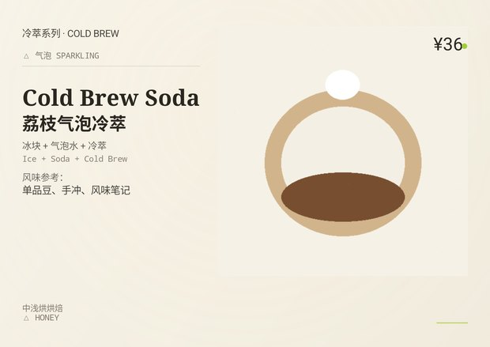
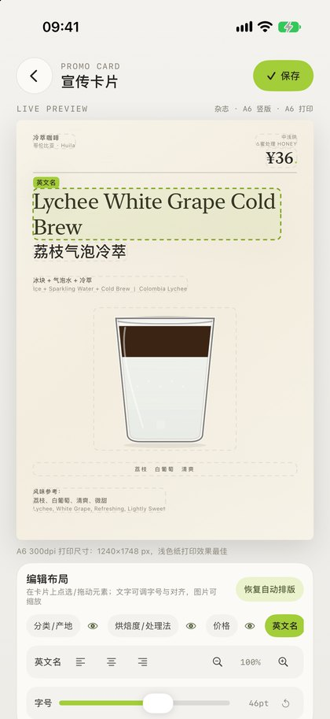
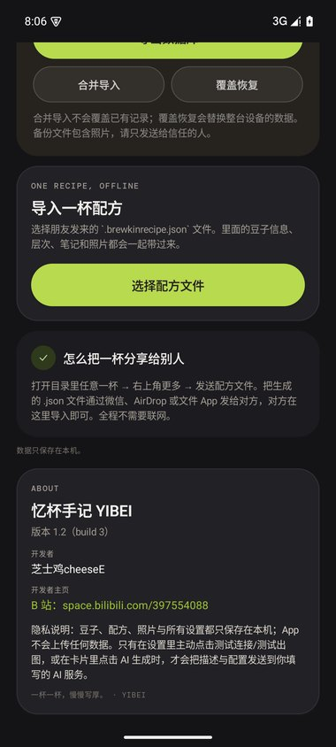
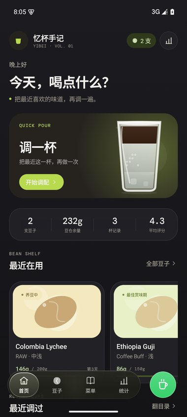

# 忆杯手记 · YIBEI（v1.2）

离线咖啡豆与配方记录 App：豆仓、调一杯、菜单/配方目录、统计；数据只保存在本机，不联网、不上传。
本仓库为 **v1.2 双端工程**（Android Kotlin + Jetpack Compose / iOS SwiftUI），包含源码、构建脚本与发行说明。

- 版本：**1.2**（Android versionCode 3 / iOS build 3）
- 开发者：**芝士鸡cheeseE** · B 站：<https://space.bilibili.com/397554088>
- 发行说明（使用/更新/安装/AI 配置）：[`忆杯手记-v1.2-发行说明.md`](忆杯手记-v1.2-发行说明.md)

## 预览

| 随杯卡·竖版 | 随杯卡·横版 | 导入图片自动抠图 |
| --- | --- | --- |
|  |  |  |

| 编辑器·字号面板 | 关于（开发者/B站） | Android 深色导航 |
| --- | --- | --- |
|  |  |  |

## 目录结构

```
app/                  Android 源码（Kotlin + Compose）
gradle/ gradlew ...   Android Gradle 工程
ios/                  iOS 工程（BeanBook.xcodeproj / SwiftUI 源码 / scripts）
docs/                 1.2 发行说明、随杯卡设计规范、编辑器 UI 规范
assets/readme/        README 预览图
忆杯手记-v1.2-发行说明.md
```

## 构建

- Android：`./gradlew :app:assembleRelease`（JDK 17 + Android SDK 35）
- iOS：`bash ios/scripts/build-all.sh`；或用 Xcode 打开 `ios/BeanBook.xcodeproj`（iOS 17+）

## 说明

- 内部包名/Bundle ID 仍沿用 `com.brewkin.beanbook` 以兼容旧版本数据与升级。
- App 内 AI 插画需在「设置 → AI 与插画 API」自行填写智谱 GLM-Image Key；不填也可手动设计/导入图片。
- 仓库不含签名密钥、构建产物与第三方参考素材。

**开发者**：芝士鸡cheeseE · **B 站**：<https://space.bilibili.com/397554088>
